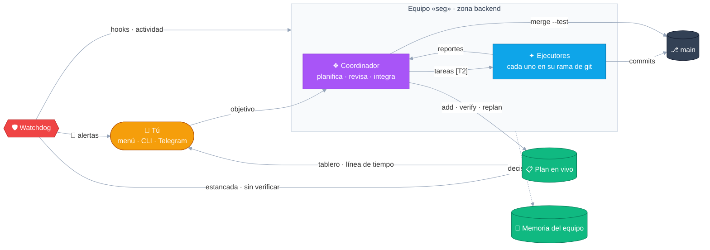

# prama-agent

[English](README.md) · **Español**

[](https://github.com/JSNN15/prama-agent/actions/workflows/ci.yml)
[](LICENSE)


[](https://scorecard.dev/viewer/?uri=github.com/JSNN15/prama-agent)

**No le creas a tus agentes. Verifica.**

prama-agent corre equipos de agentes de código de terminal,
[Claude Code](https://docs.anthropic.com/en/docs/claude-code) y Google Antigravity (`agy`), en tu propio
servidor, y verifica su trabajo en vez de creerles. Es bash sobre un servidor tmux dedicado: nada que
instalar como servicio, sin base de datos, sin Node.js. Las sesiones sobreviven a cortes de SSH, y
diriges la flota desde la terminal, la CLI o Telegram.

<p align="center">
  
</p>

## Qué verifica

| El agente dice… | prama-agent verifica |
| --- | --- |
| "Listo." | `plan verify` corre la verificación de la tarea en la rama del propio agente y registra el código de salida y el commit; un merge con tests también deja su resultado, y una lectura queda con quién la hizo. Si falla, la tarea se reabre, y un commit posterior muestra la verificación como desactualizada. *Lista* sin evidencia queda **sin verificar**. |
| "Listo para merge." | Cada agente trabaja en su propio worktree y rama de git. `worktree merge --test` prueba cada merge aparte, de a uno, y `main` solo recibe lo que pasó. |
| "Estoy en eso." | Los hooks del propio CLI informan cuando un agente está **bloqueado** y por qué (login, crédito, límite de uso, confianza en la carpeta, modelo). Una tarea sin actividad en la terminal durante 20 minutos queda **estancada**. |
| Nada (está trabado). | Nunca se escribe en un agente bloqueado: su trabajo queda en cola y se entrega cuando está listo. La alerta llega a tu celular con botones para mirar, hablarle o reiniciarlo. |
| "Me sobra cuota." | Uso de las ventanas de 5 horas y semanal, leído de la statusline de cada CLI, con alerta al 90 %. |

Un agente coordinador planifica el trabajo en un [plan en vivo](docs/GUIDE.es.md#el-plan-en-vivo) que
ves sin tener que preguntarle, y administra a sus ejecutores: los lanza, les cambia el modelo y los
reinicia, dentro de [ciertos límites](docs/GUIDE.es.md#administración-de-la-flota). Puede elegir él
mismo a sus ejecutores (agente y modelo según la tarea, el costo y la cuota que le queda a cada cuenta)
y lanzarte [asistentes](docs/GUIDE.es.md#asistentes-agentes-que-trabajan-para-ti): agentes con un
encargo a los que les hablas directamente (una guía del código, ayuda con la CLI del proyecto, textos
de marketing) mientras el equipo sigue construyendo.

## Cómo se compara

Contrastado con la documentación de cada proyecto en noviembre de 2026; las correcciones son bienvenidas.

| | prama-agent | [Herdr](https://github.com/herdrdev/herdr) | [Claude Squad](https://github.com/smtg-ai/claude-squad) | [Agent of Empires](https://github.com/agent-of-empires/agent-of-empires) | [Gas Town](https://github.com/gastownhall/gastown) | [Equipos de agentes de Claude Code](https://code.claude.com/docs/en/agent-teams) |
| --- | --- | --- | --- | --- | --- | --- |
| Corre en tu servidor, sobrevive a cortes de SSH | ✓ | ✓, varias máquinas en una vista | ✓ | ✓ | ✓ | dentro de una sesión de Claude Code (experimental) |
| CLIs de agentes | Claude Code, agy; OpenCode (experimental) | 20+ | Claude, Codex, Gemini, Aider, cualquiera | 8+ | 11 presets | solo Claude |
| Una rama de git por agente | ✓ con merge condicionado a tests | comandos de worktree; el merge es tuyo | ✓ | ✓ y contenedores | ✓ con cola de merges | por subagente, opcional |
| Agentes bloqueados y por qué | hooks del CLI + pantalla | reglas de pantalla + integraciones | pantalla | hooks + pantalla | registro + agentes vigilantes | hooks nativos |
| Cuota de 5 h / semanal | ✓ alerta al 90 % | — | — | no documentado | — | ✓ |
| Desde el celular | Telegram, con acciones | SSH, vista angosta | — | panel web | panel web | Remote Control |
| Plan contrastado con el trabajo | ✓ estancadas, sin verificar, solapadas; corre la verificación de aceptación | — | — | — | registro de issues | lista de tareas compartida |
| Runtime · licencia | bash + tmux · Apache-2.0 | Rust · Apache-2.0 | Go · AGPL-3.0 | Rust · MIT | Go · MIT | integrado |

Dónde conviene otra herramienta: **Herdr** si quieres un terminal hecho para agentes: muchos CLIs, varias
máquinas, mouse y plugins, y la coordinación queda en tus manos. **Claude Squad** si quieres un binario único que maneja cualquier CLI
de agentes, con pestaña de diff. **Agent of Empires** para muchos CLIs, sandboxes en contenedores y una
interfaz web. **Gas Town** para más de 20 agentes y una cola de merges que aísla fallas por bisección.
Los **equipos de agentes de Claude Code** si solo usas Claude y no quieres instalar nada.
**Conductor** y **Nimbalyst** si prefieres una app de escritorio con revisión de diffs.

## Por qué bash

El trabajo es unir tmux, git y los CLIs de agentes en un servidor, y bash con tmux es lo que todo
servidor ya tiene. El costo son unas 11.000 líneas de bash. Están divididas en módulos con
responsabilidades claras ([ARCHITECTURE](docs/ARCHITECTURE.md)), pasan shellcheck sin advertencias y las
cubren unas 270 comprobaciones de punta a punta sobre un servidor tmux aislado, que corren en CI con tmux
3.2a, 3.3a y 3.4. Los costos de esa decisión, y cuándo tendría sentido reescribirla, están en el
[ADR-0001](docs/adr/0001-bash-and-tmux.md) (en inglés).

## Instalación

```bash
curl -fsSL https://raw.githubusercontent.com/JSNN15/prama-agent/main/install.sh | sudo bash
prama-agent setup            # primeros pasos: acceso de los agentes, zonas (espacios de trabajo), permisos
```

Necesitas bash ≥ 4.4, tmux ≥ 3.2 y git, más al menos un CLI de agentes con sesión iniciada (`claude` o
`agy`). Las credenciales quedan en cada CLI. Se recomiendan `jq`, `fzf` y `less`, y el puente de
Telegram necesita `python3` y `curl`. Sin `sudo` se instala para el usuario actual. Probado en Ubuntu
22.04 y 24.04 y en Debian 12. **[Primeros pasos](docs/GETTING_STARTED.es.md)** va de un servidor vacío a
varios equipos.

```bash
prama-agent                                   # el menú interactivo
prama-agent swarm backend --team api --workers agy:2 --task "Agrega rate limiting a la API pública"
prama-agent plan backend --team api           # el plan del equipo, en vivo
prama-agent telegram setup                    # alertas y control desde el celular
```

## Cómo encaja todo



<table>
  <tr>
    <td width="50%"><br><sub><b>El menú</b>: equipos con sus agentes, estado, modelo y cuota.</sub></td>
    <td width="50%"><br><sub><b>El plan</b>: quién tiene cada tarea, qué está estancado, sin verificar o verificado.</sub></td>
  </tr>
  <tr>
    <td><br><sub><b>Línea de tiempo</b>: trabajo real por agente, la estimación restante, replanificaciones.</sub></td>
    <td align="center"><br><sub><b>En el celular</b>: el mismo menú, apilado, con zonas táctiles.</sub></td>
  </tr>
</table>

## Documentación

- **[La guía](docs/GUIDE.es.md)**: el menú y sus teclas, equipos y cockpit, equipos aislados, memoria
  del equipo, el plan en vivo, el celular, la API de la flota, salud y cuota, Telegram, seguridad,
  configuración.
- **[Primeros pasos](docs/GETTING_STARTED.es.md)**: de un servidor vacío a varios equipos.
- **[Decisiones de diseño](docs/adr/README.md)**: seis ADRs cortos, de "por qué bash" a "por qué el plan
  solo agrega y nunca reescribe" (en inglés). Los detalles internos están en
  [ARCHITECTURE](docs/ARCHITECTURE.md).
- **[Cómo se construyó](docs/HOW-IT-WAS-BUILT.es.md)**: con su propia flota de agentes, y lo que se
  rompió en el camino.
- **[En un servidor compartido o de producción](docs/HARDENING.es.md)**: qué protegen las barandas y
  qué no, y una configuración endurecida (sin yolo, solo proveedores permitidos, pull requests, sin
  pantallas en Telegram).
- [Hoja de ruta](docs/ROADMAP.md) · [Cambios](CHANGELOG.md) · [Contribuir](CONTRIBUTING.md) ·
  [Seguridad](SECURITY.md)

Toda la herramienta habla español e inglés, incluidos los prompts de rol de los agentes y el bot de
Telegram (`prama-agent lang`). Tiene siete temas de color (`prama-agent theme`).

## Por qué el nombre

*Prama* viene de **pramatic**, el producto para cuyo desarrollo se creó esta herramienta. Ese nombre
viene del sánscrito *pramāṇa*: en la filosofía india, el medio de conocimiento válido, el camino para
llegar a *pramā*, el conocimiento verdadero. La percepción (*pratyakṣa*), la inferencia (*anumāna*) y el
testimonio (*śabda*) están entre los medios que discuten las escuelas clásicas. prama-agent confía en
los dos primeros y desconfía del tercero: le cree a los hooks y a la terminal, infiere a partir del
plan y la actividad, y trata lo que un agente dice de su propio trabajo como un testimonio que todavía
hay que verificar.

## Autor

Creado y mantenido por **Julian Neira Nova** (Santiago de Chile) · [@JSNN15](https://github.com/JSNN15).
Construido con agentes de código de IA, últimamente orquestados por el propio prama-agent:
[cómo](docs/HOW-IT-WAS-BUILT.es.md). Si usas prama-agent en tu trabajo, [CITATION.cff](CITATION.cff)
tiene la cita.

[Licencia Apache 2.0](LICENSE) · ver [NOTICE](NOTICE). Claude Code y Antigravity son marcas de sus
respectivos dueños; este es un proyecto independiente.
