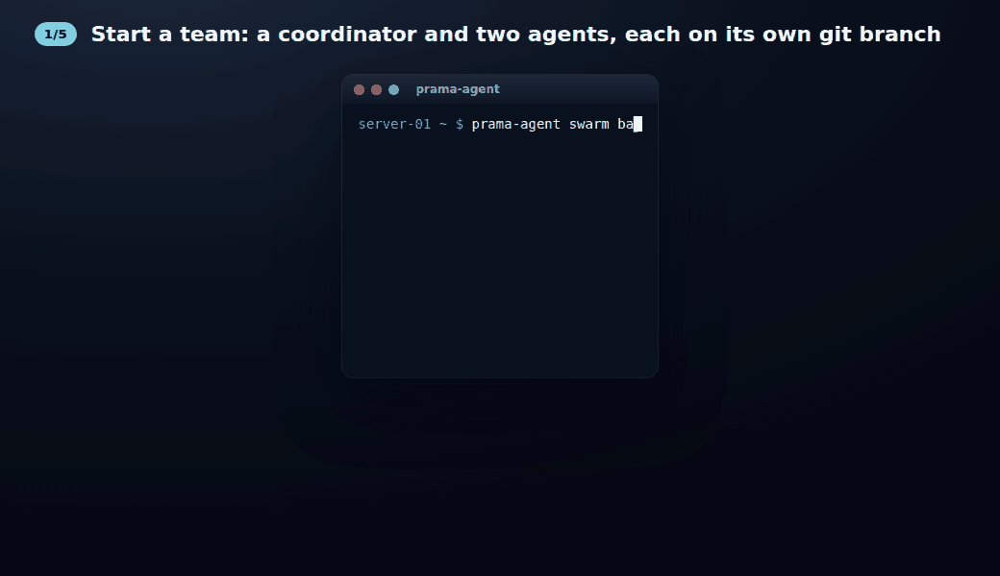
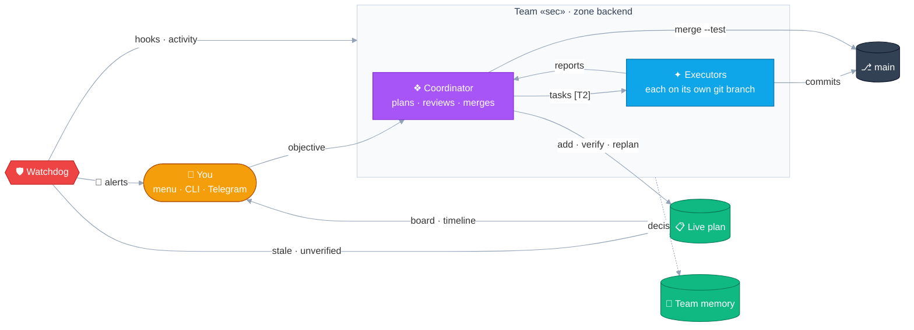
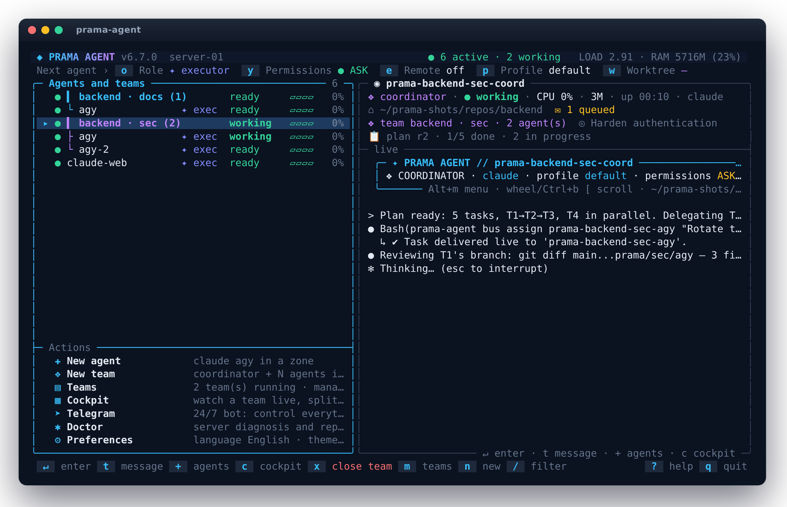
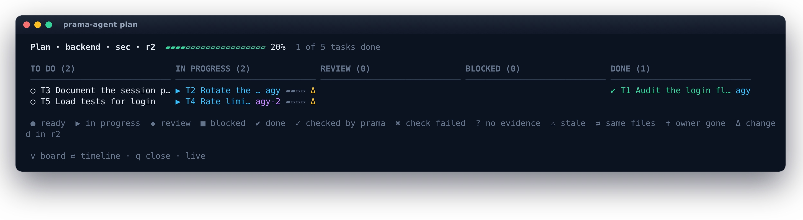
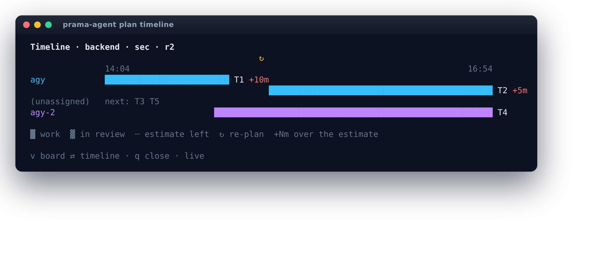
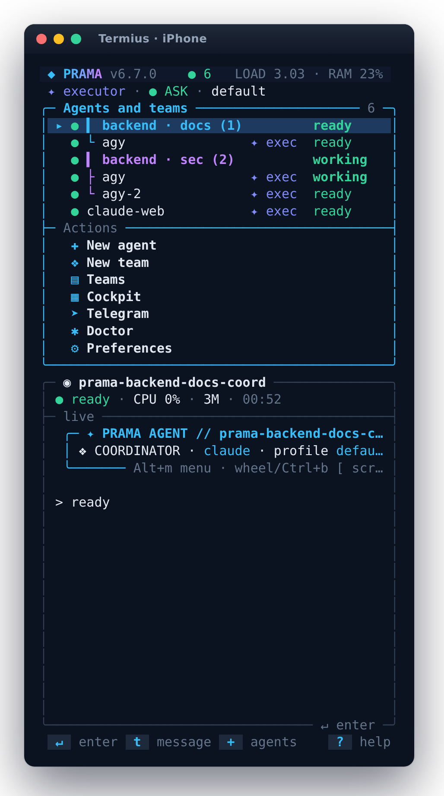

# prama-agent

**English** · [Español](README.es.md)

[](https://github.com/JSNN15/prama-agent/actions/workflows/ci.yml)
[](LICENSE)


[](https://scorecard.dev/viewer/?uri=github.com/JSNN15/prama-agent)

**Don't trust what your agents say. Check it.**

prama-agent runs teams of CLI coding agents, [Claude Code](https://docs.anthropic.com/en/docs/claude-code)
and Google Antigravity (`agy`), on your own server, and checks their work instead of taking their word
for it. It is plain bash on top of a dedicated tmux server: nothing to install as a service, no
database, no Node.js. Sessions survive SSH drops, and you steer the fleet from the terminal, the CLI
or Telegram.

<p align="center">
  
</p>

## What it checks

| The agent says… | prama-agent checks |
| --- | --- |
| "Done." | `plan verify` runs the task's acceptance command on the agent's own branch and records the exit code and commit. A failure reopens the task. *Done* with no evidence shows as **unverified**. |
| "Ready to merge." | Every agent works in its own git worktree and branch. `worktree merge --test` aborts on conflict and undoes a merge that breaks the tests, so `main` stays green. |
| "Working on it." | The CLI's own hooks report when an agent is **blocked** and why (login, credit, usage limit, folder trust, model). A task with no terminal activity for 20 minutes is flagged **stale**. |
| Nothing (it is stuck). | Nothing is typed into a blocked agent: its work is queued and delivered when it is ready. The alert reaches your phone with buttons to look, talk or restart. |
| "Plenty of quota left." | 5-hour and weekly usage, read from each CLI's status line, with an alert at 90 %. |

A coordinator agent plans the work in a [live plan](docs/GUIDE.md#the-live-plan) that you can watch
without asking it, and manages its own executors: it spawns them, switches their models and restarts
them, within [guard rails](docs/GUIDE.md#fleet-management). It can pick its executors itself (agent
and model by task, cost and the quota each account has left), and it can launch
[assistants](docs/GUIDE.md#assistants-agents-that-work-for-you) for you: agents with a brief that you
talk to directly (a guide to the codebase, help with the project's CLI, marketing copy) while the team
goes on building.

## How it compares

Checked against each project's own documentation in November 2026; corrections are welcome.

| | prama-agent | [Herdr](https://github.com/herdrdev/herdr) | [Claude Squad](https://github.com/smtg-ai/claude-squad) | [Agent of Empires](https://github.com/agent-of-empires/agent-of-empires) | [Gas Town](https://github.com/gastownhall/gastown) | [Claude Code agent teams](https://code.claude.com/docs/en/agent-teams) |
| --- | --- | --- | --- | --- | --- | --- |
| Runs on your server, survives SSH drops | ✓ | ✓, several machines in one view | ✓ | ✓ | ✓ | inside one Claude Code session (experimental) |
| Agent CLIs | Claude Code, agy; OpenCode (experimental) | 20+ | Claude, Codex, Gemini, Aider, any | 8+ | 11 presets | Claude only |
| A git branch per agent | ✓ with test-gated merge | worktree commands; merging is yours | ✓ | ✓ plus containers | ✓ with a merge queue | per subagent, opt-in |
| Blocked agents and why | CLI hooks + screen | screen rules + integrations | screen | hooks + screen | ledger + watchdog agents | native hooks |
| 5 h / weekly quota | ✓ alert at 90 % | — | — | not documented | — | ✓ |
| From your phone | Telegram, with actions | SSH, narrow layout | — | web dashboard | web dashboard | Remote Control |
| Plan checked against the work | ✓ stale, unverified, overlap; runs the acceptance check | — | — | — | issue ledger | shared task list |
| Runtime · license | bash + tmux · Apache-2.0 | Rust · Apache-2.0 | Go · AGPL-3.0 | Rust · MIT | Go · MIT | built in |

Where others are the better choice: **Herdr** for a terminal built around agents: many CLIs, several
machines, mouse and plugins, with the coordination left to you. **Claude Squad** for one binary that drives any agent CLI, with a
diff tab. **Agent of Empires** for many CLIs, container sandboxes and a web UI. **Gas Town** for 20+
agents and a merge queue that bisects failures. **Claude Code agent teams** if you only use Claude and
want nothing to install. **Conductor** and **Nimbalyst** for a desktop app with diff review.

## Why bash

The job is gluing tmux, git and the agent CLIs together on a server, and bash plus tmux is what every
server already has. The cost is about 11,000 lines of bash. They are split into modules with clear
owners ([ARCHITECTURE](docs/ARCHITECTURE.md)), clean under shellcheck, and covered by about 270
end-to-end checks on an isolated tmux server, run in CI on tmux 3.2a, 3.3a and 3.4. The trade-offs, and
when a rewrite would make sense, are in [ADR-0001](docs/adr/0001-bash-and-tmux.md).

## Install

```bash
curl -fsSL https://raw.githubusercontent.com/JSNN15/prama-agent/main/install.sh | sudo bash
prama-agent setup            # first steps: agent sign-in, zones (workspaces), permissions
```

You need bash ≥ 4.4, tmux ≥ 3.2 and git, plus at least one signed-in agent CLI (`claude` or `agy`).
Credentials stay with each CLI. `jq`, `fzf` and `less` are recommended, and the Telegram bridge needs
`python3` and `curl`. Without `sudo` it installs for the current user. Tested on Ubuntu 22.04 and 24.04
and Debian 12. **[Getting started](docs/GETTING_STARTED.md)** goes from an empty server to several
teams.

```bash
prama-agent                                   # the interactive menu
prama-agent swarm backend --team api --workers agy:2 --task "Add rate limiting to the public API"
prama-agent plan backend --team api           # the team's plan, live
prama-agent telegram setup                    # alerts and control from your phone
```

## How it fits together



<table>
  <tr>
    <td width="50%"><br><sub><b>The menu</b>: teams grouped with their agents, state, model and quota.</sub></td>
    <td width="50%"><br><sub><b>The plan</b>: who has each task, what is stale, unverified or checked.</sub></td>
  </tr>
  <tr>
    <td><br><sub><b>Timeline</b>: real work per agent, the estimate left, re-plans.</sub></td>
    <td align="center"><br><sub><b>On a phone</b>: the same menu, stacked, with tap targets.</sub></td>
  </tr>
</table>

## Documentation

- **[The guide](docs/GUIDE.md)**: the menu and its keys, teams and the cockpit, isolated teams, team
  memory, the live plan, the phone, the fleet API, health and quota, Telegram, security,
  configuration.
- **[Getting started](docs/GETTING_STARTED.md)**: from an empty server to several teams.
- **[Design decisions](docs/adr/README.md)**: six short ADRs, from "why bash" to "why the plan is
  append-only". The internals are in [ARCHITECTURE](docs/ARCHITECTURE.md).
- **[How it was built](docs/HOW-IT-WAS-BUILT.md)**: with its own fleet of agents, and what broke on the
  way.
- **[On a shared or production host](docs/HARDENING.md)**: what the guard rails do and do not
  protect, and a hardened configuration (no yolo, allowed providers only, pull requests, no screens on
  Telegram).
- [Roadmap](docs/ROADMAP.md) · [Changelog](CHANGELOG.md) · [Contributing](CONTRIBUTING.md) ·
  [Security](SECURITY.md)

The whole tool, including the agents' role prompts and the Telegram bot, speaks English and Spanish
(`prama-agent lang`). It has seven color themes (`prama-agent theme`).

## Why the name

*Prama* comes from **pramatic**, the product this tool was built to develop. That name comes from the
Sanskrit *pramāṇa*: in Indian philosophy, the means of valid knowledge, the way to reach *pramā*,
knowledge that is true. Perception (*pratyakṣa*), inference (*anumāna*) and testimony (*śabda*) are
among the means the classical schools discuss. prama-agent relies on the first two and is wary of the
third: it believes the hooks and the terminal, infers from the plan and the activity, and treats what
an agent says about its own work as testimony that still has to be checked.

## Author

Created and maintained by **Julian Neira Nova** (Santiago de Chile) · [@JSNN15](https://github.com/JSNN15).
Built with AI coding agents, most recently orchestrated by prama-agent itself:
[how](docs/HOW-IT-WAS-BUILT.md). If you use prama-agent in your work, [CITATION.cff](CITATION.cff) has
the citation.

[Apache License 2.0](LICENSE) · see [NOTICE](NOTICE). Claude Code and Antigravity are trademarks of
their respective owners; this is an independent project.
