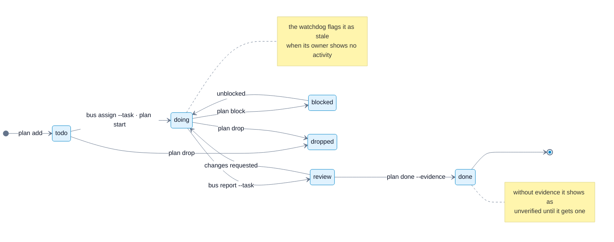
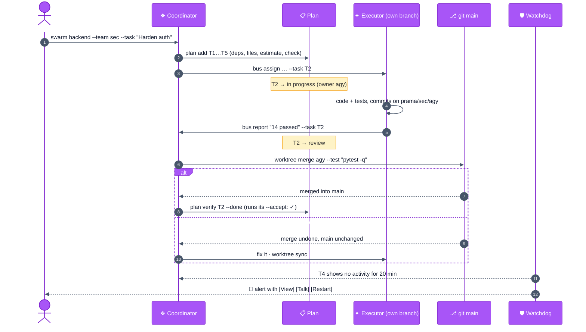

# prama-agent guide

**English** · [Español](GUIDE.es.md) · [README](../README.md)

Everything prama-agent does, one section per topic. New here? Start with
[Getting started](GETTING_STARTED.md). Design decisions and their trade-offs: [ADRs](adr/README.md).

- [The interactive menu](#the-interactive-menu)
- [Teams and the cockpit](#teams-and-the-cockpit) · [isolated teams](#isolated-teams-a-branch-per-agent) · [team memory](#team-memory)
- [The live plan](#the-live-plan)
- [On your phone](#on-your-phone) · [Telegram](#telegram-control-from-your-phone)
- [Fleet management](#fleet-management) · [health and quota](#how-health-and-quota-are-collected)
- [Roles and swarms](#roles-and-swarms) · [Presets](#presets) · [LLM profiles](#llm-profiles)
- [Permissions and security](#permissions-and-security)
- [Languages and themes](#languages-and-themes) · [Configuration](#configuration)
- [Reporting bugs](#reporting-prama-agent-bugs-agents-included) · [Status and roadmap](#status-and-roadmap) · [Migrating from v5](#migrating-from-v5) · [Development](#development)

## The interactive menu

`prama-agent` with no arguments opens it. The keybar always shows the keys for what is selected (destructive ones
in red), and `?` opens every shortcut grouped by task:

| Key | Action | Key | Action |
| --- | --- | --- | --- |
| `↑↓` `jk` `1-9` | move | `↵` | enter the session / choose |
| `n` | new agent (wizard) | `s` | new team (coordinator + N agents) |
| `m` | **teams**: cockpit, message, add agents, memory, close | `+` | add agents to the selected team |
| `t` | send a task (to a coordinator: a message) | `c` | team cockpit |
| `l` | history (`less`) | `r` / `x` | restart / close (asks first) |
| `/` | filter | `f` | `fzf` inspector with preview |
| `,` | preferences: language, theme, mouse | `?` | help |
| `o` `y` `e` `p` `w` `g` | role · permissions · remote · LLM profile · worktree · background | `q` | quit |

Sessions are grouped by team: the coordinator row is the team (`▍ backend · sec (2)`, one color per
team) and its agents hang below it (`├ agy`, `└ agy-2`); `x` on a coordinator closes the whole team and
nothing else. The layout adapts to the terminal width (side by side from 100 columns, stacked on a
phone), refreshes every 2 s and supports touch and mouse wheel.

A **zone** is a named working directory, usually a repository: `prama-agent zones add backend /srv/api`
(or `setup`), `zones scan` lists the repositories not registered yet. Until you register one, every git
repository under `PRAMA_DISCOVER_ROOTS` (`/opt`, `$HOME`) is a zone.

## Teams and the cockpit

```bash
prama-agent swarm backend --team arquitectura --workers agy:2 --task "Split the billing module"
prama-agent swarm backend --team seguridad --workers agy:1,claude:1 --worker-model gemini-3.8-flash-high
prama-agent swarm backend --team docs --workers agy:1 --task "Document the public API"
prama-agent teams                                 # every team: zone, name, coordinator, agents, objective
prama-agent cockpit backend --team seguridad      # live split view of one team
prama-agent swarm stop backend --team docs        # close one team (coordinator + its agents)
```

**Several teams per zone.** Each team has a name unique in its zone, its own coordinator, objective
and cockpit, and they never mix: an agent's reports and alerts go to its own coordinator, `bus assign
executor` from a coordinator picks one of its own agents, and a coordinator cannot manage, grow or stop
another team. `swarm` with an existing team name adds workers to it; without `--team` it creates the
zone's `principal` team, or asks for a name if the zone already has teams.

The coordinator receives the list of its team and the objective as soon as it is ready, delegates
through the bus and can grow its own team (`swarm <its zone> --workers agy:2`), switch models or close
agents.

The **cockpit** shows the coordinator on the left, its agents stacked on the right and the live bus
below; it is rebuilt automatically when agents join or leave. Inside prama's tmux, from any agent or
from the cockpit:

| Key | Status-bar button | Action |
| --- | --- | --- |
| `Alt+m` | `◂ MENU` | back to the menu (agents keep running) |
| `Alt+a` | `☰ AGENTS` | agent list (teams, state, model, quota): jump to any agent or cockpit |
| `Alt+c` | `▦ COCKPIT` | team cockpit ⇄ the agent in focus |
| `Ctrl+b n` / `Ctrl+b p` | `▶` / `◀` (phone) | next / previous agent; inside the cockpit, the next / previous pane |
| `Ctrl+b z` | | zoom the focused cockpit pane |

Keys are configurable (`PRAMA_MENU_KEY`, `PRAMA_NAV_KEY`, `PRAMA_COCKPIT_KEY`); the buttons work by
touch in Termius, Blink or any terminal with mouse support.

### Isolated teams: a branch per agent

Several agents editing one folder overwrite each other. So a new team in a git zone is **isolated**:
each executor works in its own git worktree (outside the repository) on branch `prama/<team>/<name>`,
created from the branch the zone is on; the coordinator stays on that branch and integrates.

```bash
prama-agent swarm backend --team sec --workers agy:2        # isolated (default; --shared to opt out)
prama-agent worktree status backend --team sec              # each branch: to merge, uncommitted, behind
prama-agent worktree merge prama-backend-sec-agy --test "pytest -q"   # merge; undone if the tests fail
prama-agent worktree sync prama-backend-sec-agy-2           # bring a branch up to date with the base
```

- `merge` refuses a dirty base checkout, and **aborts on conflict**: the base never stays broken; the
  executor runs `worktree sync`, resolves in its own worktree, commits, and the coordinator merges again.
  With `--test` (or `PRAMA_MERGE_TEST`) a merge that breaks the tests is undone.
- Only the coordinator (or you) merges; an executor only commits to its branch and syncs itself.
- Role prompts carry the protocol: executors commit with evidence, coordinators split work by files,
  merge one branch at a time and ask the others to sync.
- `swarm stop` removes the worktrees that are clean and merged and **keeps** any with unmerged or
  uncommitted work (`worktree clean` does the same later).
- Dependencies: each worktree is a fresh checkout. `.env` files are copied (`PRAMA_WORKTREE_COPY_FILES`);
  `PRAMA_WORKTREE_LINK="node_modules .venv"` shares heavy directories with the main checkout instead
  of reinstalling them; otherwise executors install what they need.
- In the menu, the new-team wizard asks *a branch per agent* or *shared folder*, and **Teams →
  Branches** shows the state of every branch; in Telegram, team → **⎇ Branches**.

### Team memory

A conversation dies with its agent (a restart, a model change, a quota); the team's decisions should not.
Every team has a shared memory of short, dated notes, and every zone one shared by all its teams:

```bash
prama-agent memory show backend --team sec        # the zone's notes, then the team's
prama-agent memory add backend --team sec "JWT keys rotate daily; never log them"
prama-agent memory add backend --zone-wide "Python 3.12, FastAPI, tests with pytest -q"
prama-agent memory                                # every memory: zone, team, notes, last change
```

The agents use it themselves: their role prompt tells them to read it when they start and to record
decisions, conventions and where the work stands with `prama-agent memory add` (an agent writes to its
own team). The coordinator's brief says how many notes are waiting, so a restarted coordinator or a new
worker picks the work up where it was. Notes live on the server (`~/.local/state/prama-agent/memory`,
mode `0700`), redacted like bug reports, newest `PRAMA_MEMORY_MAX_LINES` (200) kept; only the operator
can clear one. The menu (**Teams → Team memory**) and Telegram (**🧠 Memory**) show and add notes too.

## The live plan

You should not have to ask the coordinator what it is doing. It keeps the team's plan with one-line
commands, prama shows it live, and the watchdog checks it against what the agents actually do.

```bash
prama-agent plan add "Rotate the JWT keys" --deps T1 --est 90m --scope "src/auth/keys.py" --accept "pytest tests/auth"
prama-agent bus assign prama-backend-sec-agy "Rotate the keys, no downtime" --task T2   # T2 → in progress
prama-agent bus report "14 passed @3f9c2a1" --task T2                                     # (executor) T2 → review
prama-agent plan done T2 --evidence "pytest tests/auth: 14 passed"
prama-agent plan verify T2 --done            # prama runs T2's --accept on the agent's branch: pass → done ✓
prama-agent plan replan "The audit asks for rate limiting first"                          # r2, kept in the history
prama-agent plan backend --team sec            # board  ·  plan timeline  ·  plan log  ·  plan html
```

- **Board and timeline, live**: in the team's cockpit (a pane of its own), in the menu (**Teams →
  📋 Plan**, `v` switches views), in Telegram (team → **📋 Plan**) and as a self-contained HTML file.
- **Made for plans that change**: every re-plan is a numbered revision with its reason, marked on the
  timeline (↻) and on the tasks it touched (Δ); the history is never rewritten.
- **Checked, not claimed.** `plan verify T2` (or `plan done T2 --verify`) runs the task's acceptance
  command (`--accept`) where the work is, the owner's worktree in an isolated team, and records the
  exit code and the commit: a pass shows as **✓ checked by prama**; a failure shows as **✖**, reopens a
  task that was marked done and reaches Telegram. Evidence written by hand (`--evidence`, or the text of
  an agent's `bus report --task`) is kept for what it is, a claim; *done* with no evidence at all is
  **unverified**. At a terminal, the operator confirms the command before it runs.
- **Flags derived from what the agents actually do**: a task *in progress* with no terminal activity
  from its owner for `PRAMA_PLAN_STALE_MIN` (20) minutes is **stale**, one whose owner is gone is an
  **orphan**, two tasks in progress whose declared file scopes overlap are **overlapping**, and a task
  whose dependencies are done but nobody has is **ready**. The watchdog tells the coordinator and
  Telegram, once an hour per task and kind.
- Only the coordinator (or you) changes the plan; an executor moves its own task (progress, report).

How a task moves:




A task, from plan to `main`:



## On your phone

The cockpit is at its best on a tablet or a computer, and it is designed to work on a phone too:

- **Compact layout, automatic.** On a screen narrower than `PRAMA_COMPACT_COLS` (100 columns) the
  cockpit shows one agent at a time, full screen, and the status bar turns into large tap targets:
  `◂` menu · `◀` previous · `☰` agents · `▶` next · `▦` cockpit. Rotate to landscape or open the same
  session on a computer and the split view comes back. A zoom you chose with `Ctrl+b z` is left alone.
  (tmux ≥ 3.3; with 3.2, zoom by hand with `Ctrl+b z`.)
- **The menu adapts** to the width: a single column, short labels, the live preview of the selected
  agent below the list.
- **Use mosh.** It keeps the connection through Wi-Fi ↔ mobile data changes, tunnels and a locked
  screen, where SSH drops. On the server: `sudo apt install mosh` and open UDP 60000-61000; on the
  phone, Termius or Blink: `mosh user@server -- prama-agent`. `prama-agent doctor` tells you whether
  mosh is available.
- **Telegram for a quick look.** Team status, quota, talking to the coordinator or closing a team
  takes two taps from the bot (see below), with no terminal at all.

## Fleet management

The fine-grained API behind teams, available to you and to a coordinator; add `--json` for machine
output.

```bash
prama-agent fleet status --json              # state, block reason, model, preset, queue, quota
prama-agent fleet spawn agy backend --preset cheap --task "Add tests for utils/date.ts"
prama-agent fleet model prama-claude-backend-2 sonnet      # same pane, same conversation
prama-agent fleet edit  prama-claude-backend-2 --effort high --preset reviewer
prama-agent fleet restart <session> · fleet kill <session> · fleet presets · fleet models agy
prama-agent fleet hooks status               # health hooks per agent CLI
```

- **Watchdog.** An internal session starts with the first agent and stops when the fleet is empty. It
  alerts the agent's team coordinator (the zone's coordinators for an agent outside a team) and
  Telegram, if configured, when an agent becomes blocked, stops, recovers or crosses the quota
  threshold, and delivers queued tasks once the agent is ready again.
- **Guard rails for agents** (against mistakes; see *Permissions and security*). An agent cannot act on itself or on a coordinator, only within its
  scope (`PRAMA_FLEET_SCOPE=zone|children|all`), and `spawn` honours `PRAMA_FLEET_MAX`. Every action
  is logged on the bus.
- **Model changes never touch your defaults.** prama restarts the agent with `--model` instead of
  typing `/model`, which in Claude Code also rewrites your global default. agy model ids are
  validated against `agy models`, since agy silently falls back to its default on unknown ids.

### How health and quota are collected

| | Claude Code | Antigravity (`agy`) |
| --- | --- | --- |
| Hooks | `SessionStart`, `UserPromptSubmit`, `Stop`, `StopFailure`, `Notification`, … injected per session with `--settings` | `SessionStart`, `PreInvocation`, `Stop` (error text classified) |
| Where | session only; `~/.claude` is not modified | one named entry, `prama-agent`, in `~/.gemini/config/hooks.json` (agy has no per-session hooks); a no-op outside prama panes; `fleet hooks uninstall` removes it |
| Quota | status line `rate_limits` (5 h / 7 d) | status line `quota` buckets of the active model family |
| Resume | `--session-id` / `--resume <id>` | `--conversation <id>` (id reported by the hooks) |

The hooks decide whether an agent is **blocked** and why. Whether it is idle or working is still read
from its screen, which also catches the dialogs shown before hooks run (login, folder trust, model
picker). If you already use a custom Claude Code status line, prama chains it.

## Roles and swarms

| Role | Purpose |
| --- | --- |
| `✦ executor` | implements and tests; reports with `prama-agent bus report` |
| `❖ coordinator` | plans, delegates with `bus assign`, manages the fleet |
| `◉ reader` | read-only reviewer (plan mode) |
| `♺ daemon` | works through a task queue in a loop (`--loop 60 --task "…"`) |

```bash
prama-agent bus assign prama-agy-backend-2 "Implement /health and run pytest"
prama-agent bus assign executor "…"              # by role: the most recent executor
prama-agent bus report "Endpoint ready; 18/18 tests pass"
prama-agent bus watch                            # live events
```

`assign` takes an exact session name or a role and never matches partially. Text is only typed into
agents that are ready or working; anything else is queued (Maildir queues, multi-consumer safe)
and the watchdog delivers it once the agent is ready. A usage-limit block is retried after
`PRAMA_BLOCK_TTL` (15 min); `prama-agent send` is a raw passthrough.

## Presets

`--preset <name>` applies an agent, model, effort, role, extra prompt and a skills folder in one go.
Bundled: `reviewer` (Claude, read-only), `architect` (Claude, extra-high effort) and `cheap` (agy Flash
for mechanical work). Your own go in `~/.config/prama-agent/presets/<name>.env`; a `SKILLS_DIR` with
`<skill>/SKILL.md` folders is mounted as a plugin for that agent only. See
[presets/README.md](../presets/README.md).

## Permissions and security

| Mode | Flag | Behaviour |
| --- | --- | --- |
| **ASK** (default) | `--ask` | the agent asks before each action |
| **PLAN** | `--plan`, `--role reader` | the CLI's native read-only mode |
| **YOLO** | `--yolo`, `PRAMA_SKIP_PERMISSIONS=1` | no confirmations; for isolated servers you control |

Design guarantees (details in [docs/ARCHITECTURE.md](ARCHITECTURE.md)):

- A **dedicated tmux server**; your own tmux sessions and `~/.tmux.conf` are never touched.
- Runtime state lives in `~/.local/state/prama-agent` (mode `0700`); nothing in `/tmp`.
- State, queues and events are data: never `source`d or `eval`ed. (Configuration files are sourced
  on purpose; `plan verify` runs the coordinator's `--accept` command after showing it.)
- API keys never appear on a command line (`ps`); they are applied inside the agent's pane.
- Exact tmux targets: stopping `prama-claude` never closes `prama-claude-backend`.
- Stopping a session sends TERM, then KILL, to each pane's process group, so an agent that ignores
  `SIGHUP` does not survive it.
- **Roles are guard rails, not a sandbox.** Who may merge, change the plan or manage the fleet is
  decided by the caller's `PRAMA_SESSION`; an agent with a shell could unset it. The rules prevent
  mistakes; to contain a hostile agent, run the agents as a separate user, in a container or a VM.

Report vulnerabilities as described in [SECURITY.md](../SECURITY.md).

## Telegram (control from your phone)

```bash
prama-agent telegram setup     # paste the @BotFather token, then send the one-time code to the bot
prama-agent telegram start     # 24/7 bot in a persistent session (status | logs | restart | stop)
```

One-time pairing code (only your chat and user are authorised), inline menus and argument
whitelists. From the bot you can:

- **Teams** (`/teams`): every team, several per zone, with its agents, state, model and quota; *talk
  to the coordinator* (what you write next goes to it), view its screen, add a worker, or close that
  team (with confirmation). *New team* asks for the zone, the team (an existing one, a suggested name or
  your own) and the workers (`agy × 1-3`, …), then takes your next message as the objective.
- **Alerts** (`/alerts`): agents that need you (blocked by a login, credit or quota, stopped, or past
  90 % of a quota window), each with *view screen*, *restart* and *close*. The watchdog's alerts also
  arrive as messages with *view screen*, *talk* and *restart* buttons, so you act on them in one tap;
  plan alerts and failed acceptance checks come with the team's buttons.
- **Daemons** (`/daemons`): daemon agents with their state and queue; *queue a task* takes your next
  message.
- **Team memory** (team → 🧠 Memory): the team's latest notes; *add a note* takes your next message.
- **Notifications** (`/notify`): choose what the bot sends — everything, important (no bus traffic),
  alerts only, or nothing — and `/mute 1h` (30m, 8h, 24h, off) to receive them without sound.
  Also from the server: `prama-agent telegram alerts important`, `prama-agent telegram mute 8h`.
- **Quota** (`/quota`): 5 h / 7 d / context per agent, flagged at 90 %.
- **Agents**: view a screen, talk, launch, restart or stop; **bug reports** from agents (`/reports`).

Commands work in both languages (`/teams` = `/equipos`, `/alerts` = `/alertas`, `/mute` = `/silencio`…);
the bot's menu and texts follow the interface language.

The bot is a remote terminal: protect your Telegram account with two-step verification.

## Reporting prama-agent bugs (agents included)

Agents use prama all day, so they are the first to notice when it misbehaves. Every role prompt
includes an internal channel for that:

```bash
prama-agent feedback "fleet model agy-backend-2 gemini-4-argon-medium: restarted with the old model"   # agent or you
prama-agent feedback list                  # open reports (also in doctor, the menu and Telegram /reportes)
prama-agent feedback show <id>             # report + context: version, agent, model, state, recent bus events
prama-agent feedback export <id> | gh issue create -R JSNN15/prama-agent -t "…" -F -
prama-agent feedback close <id>
```

Reports stay on the server (`~/.local/state/prama-agent/feedback`, mode `0700`), with provider keys and
token-like strings redacted. A repeated report is counted instead of duplicated, the operator is
notified (bus and Telegram), and **nothing is published without you**: `export` produces the Markdown
for the [bug report template](../.github/ISSUE_TEMPLATE/bug_report.yml), you review it and post it.

## LLM profiles

`--profile` points Claude Code at another Anthropic-compatible endpoint: `openrouter`, `deepseek`,
`glm` or `local` (a router such as claude-code-router). Keys live in `providers.env` (`chmod 600`).

```bash
prama-agent profiles
prama-agent claude backend --profile deepseek
```

## Languages and themes

The whole tool speaks both languages: menu, CLI, the
agents' role prompts (so agents report in your language), the Telegram bot. It follows your locale
(`es_*` → Spanish), or choose with `prama-agent lang en|es|auto`. `prama-agent theme` shows the themes
(midnight, ocean, forest, ember, violet, light for light terminals, mono for high contrast); they paint
the menu, the tmux status bar of every agent and the fzf inspector. Both are also in the menu, under
**⚙ Preferences** (`,`), where moving through the themes previews them live.

## Configuration

`/etc/prama-agent/config.env`, then `~/.config/prama-agent/config.env` (bash syntax, see
[config/config.env.example](../config/config.env.example)).

| Variable | Default | |
| --- | --- | --- |
| `ZONES` / `ZONE_DIRS` | discovered | named working directories |
| `PRAMA_SKIP_PERMISSIONS` | `0` | `1` = YOLO by default |
| `PRAMA_DEFAULT_REMOTE` | `0` | enable the CLIs' remote control by default |
| `PRAMA_FLEET_MAX` / `PRAMA_FLEET_SCOPE` | `8` / `zone` | fleet limits for agents |
| `PRAMA_HOOKS` / `PRAMA_STATUSLINE` | `1` / `1` | health hooks / quota telemetry |
| `PRAMA_QUOTA_WARN` | `90` | quota alert threshold (%) |
| `PRAMA_WATCHDOG` | `1` | fleet watchdog |
| `PRAMA_SWARM_WORKERS` | `agy:2` | default workers for `swarm` |
| `PRAMA_MENU_KEY` / `PRAMA_NAV_KEY` / `PRAMA_COCKPIT_KEY` | `M-m` / `M-a` / `M-c` | navigation keys inside tmux |
| `PRAMA_COMPACT_COLS` | `100` | clients narrower than this get the phone layout |
| `PRAMA_FEEDBACK_MAX_OPEN` | `50` | open bug reports before agents are asked to wait |
| `PRAMA_SWARM_ISOLATE` | `1` | new teams in a git zone: a worktree and branch per executor |
| `PRAMA_WORKTREE_LINK` | — | directories symlinked from the main checkout into each worktree (`node_modules .venv`) |
| `PRAMA_MERGE_TEST` | — | test command run after every `worktree merge` (the merge is undone if it fails) |
| `PRAMA_LANG` | `auto` | interface language: `en`, `es`, `auto` (from the locale); `prama-agent lang` |
| `PRAMA_THEME` | `midnight` | color theme; `prama-agent theme` lists them |
| `PRAMA_TUI_MOUSE` | `1` | mouse and touch in the menu |
| `PRAMA_TG_NOTIFY` | `all` | Telegram notifications: `all`, `important`, `alerts`, `off` (the bot's `/notify` overrides it) |
| `PRAMA_MEMORY_MAX_LINES` | `200` | notes kept per team / zone memory |
| `PRAMA_PLAN_STALE_MIN` | `20` | minutes without activity before a task in progress is flagged stale |
| `PRAMA_VERIFY_TIMEOUT` | `1800` | seconds `plan verify` lets an acceptance check run |
| `PRAMA_EXPERIMENTAL` | `0` | enable experimental agents (OpenCode) |

**Worktrees** (`-w <branch>`) are created outside the repository
(`<parent>/.prama-worktrees/<repo>/<branch>`), reuse an existing branch without resetting it, and copy
`.env`, `.env.local` and `.mcp.json`.

## Status and roadmap

| Agent | Status |
| --- | --- |
| Claude Code | supported: hooks, quota, resume, presets, remote control |
| Antigravity (`agy`) | supported: hooks, quota, resume, model validation, remote control |
| OpenCode | **experimental**, integrated and tested but off by default (`PRAMA_EXPERIMENTAL=1`) |
| Hermes Agent | **under evaluation**, not integrated |

Running agents on other servers over SSH from the same prama-agent is a planned feature.

OpenCode and Hermes are the two serious candidates for running open-weight models (Qwen, Kimi, GLM,
DeepSeek) through OpenRouter as low-cost workers. The evaluation and the criteria for enabling them
are in [docs/ROADMAP.md](ROADMAP.md).

## Migrating from v5

`prama-agent doctor` detects and cleans up what v5 left behind: it removes the insecure
`/tmp/prama-bus`, `doctor --restore-tmux-conf` restores your original `~/.tmux.conf`, and it lists agents
running outside prama (they do not survive an SSH drop). v5 sessions lived on your personal tmux server;
v6 uses its own.

## Development

```bash
make lint          # bash -n, shellcheck, py_compile
make test          # Telegram bot unit tests + end-to-end suite on an isolated tmux server, HOME and state
make test-matrix   # the CI matrix in local containers: Ubuntu 22.04, Debian 12, Ubuntu 24.04
make screenshots   # docs/img/*.png from a demo fleet (needs chromium)
make demo         # docs/img/demo-*.gif, the README demo (chromium + python3-pil)
```

CI runs the suite in clean containers (tmux 3.2a, 3.3a, 3.4; an unprivileged user with a `/bin/sh`
login shell), plus shellcheck, actionlint, CodeQL and OpenSSF Scorecard. Actions are pinned by commit
SHA and kept current by Dependabot; releases are published from the tag and `CHANGELOG.md`.

Architecture, security invariants and internal API: [docs/ARCHITECTURE.md](ARCHITECTURE.md).
Contributing: [CONTRIBUTING.md](../CONTRIBUTING.md). Changes: [CHANGELOG.md](../CHANGELOG.md).
